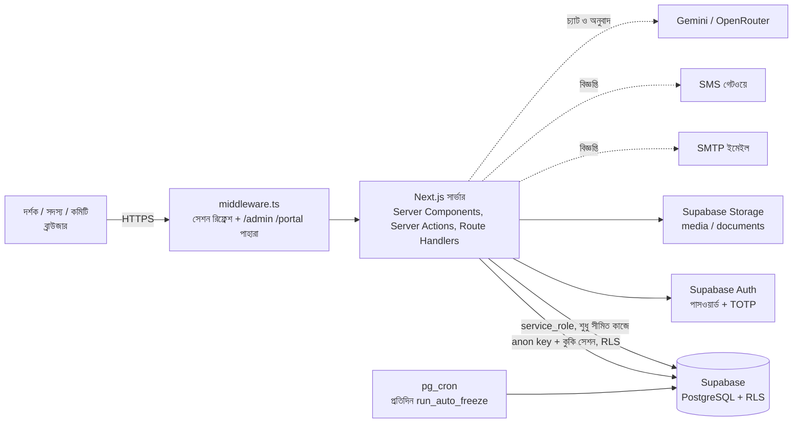
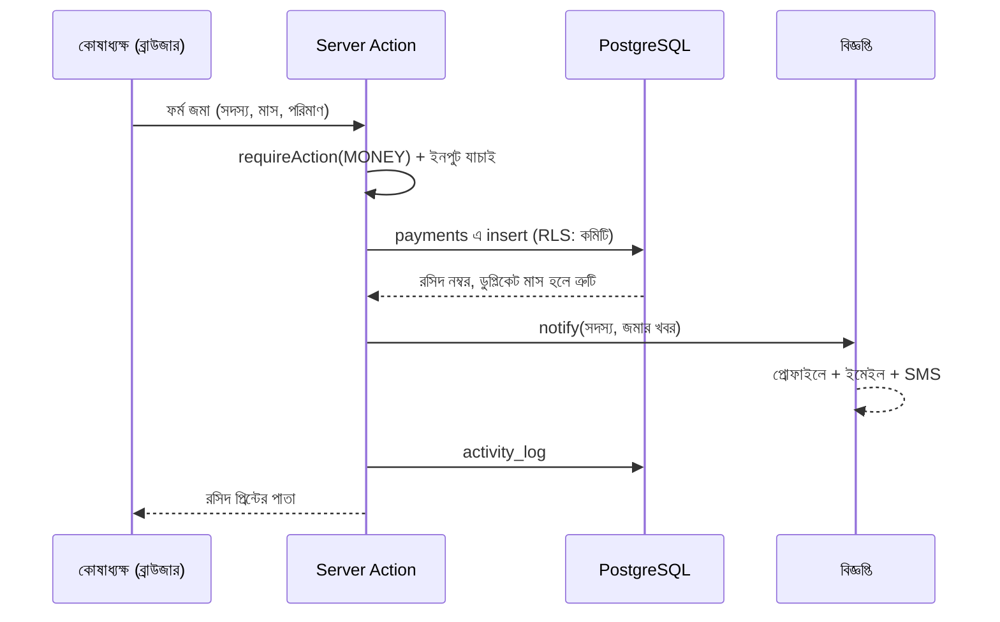

<div align="center">

# হিলফুল ফুজুল পাঠাগার ও যুব সংঘ

### ওয়েবসাইট ও সংগঠন ব্যবস্থাপনা সফটওয়্যার
**Hilful Fuzul Library & Youth Association: public website + management system**


[লাইভ ডেমো](https://hilful-fuzul-app.vercel.app) · [ডেভেলপার পোর্টফোলিও](https://www.manikhossain.in/) · [সেটআপ](#১০-সেটআপ-প্রথমবার) · [আর্কিটেকচার](#৪-আর্কিটেকচার-ফ্রন্টএন্ড-ও-ব্যাকএন্ড-কীভাবে-কাজ-করে) · [পেজ বিল্ডার](#৭-পেজ-বিল্ডার-ও-কনটেন্ট-সিস্টেম)

<sub>Designed and developed by <b>Manik Hossain</b> · <a href="https://www.manikhossain.in/">Portfolio</a> · <a href="https://github.com/procoder-manik">GitHub</a></sub>

</div>

---

## English summary

A full-stack web application for a community organisation in Bangladesh. It combines a **bilingual (Bangla/English) public website** with a **role-based management system** for interest-free loans (Qard al-Hasan), monthly member contributions, donations, a lending library, events, notifications and a built-in **drag-and-drop page builder**.

* **Stack:** Next.js 14 (App Router, Server Components, Server Actions), React 18, TypeScript (strict), Supabase (PostgreSQL with Row Level Security, Auth with TOTP MFA, Storage, `pg_cron`), Chart.js, ExcelJS, Nodemailer. No UI framework: a single hand-written design-token stylesheet.
* **Why:** to replace paper registers and spreadsheets with a transparent, auditable system that the committee can run without a developer, while every member can see their own dues and the public can see where every taka goes.
* **Run it:** create a Supabase project, run `supabase/migrations/001..008`, copy `.env.example` to `.env.local`, then `npm install && npm run seed && npm run dev`. Details below (in Bangla).

---

## সূচিপত্র

1. [প্রজেক্ট পরিচিতি](#১-প্রজেক্ট-পরিচিতি)
2. [ফিচারের পূর্ণ তালিকা](#২-ফিচারের-পূর্ণ-তালিকা)
3. [টেকনোলজি স্ট্যাক ও সিদ্ধান্তের কারণ](#৩-টেকনোলজি-স্ট্যাক-ও-সিদ্ধান্তের-কারণ)
4. [আর্কিটেকচার: ফ্রন্টএন্ড ও ব্যাকএন্ড কীভাবে কাজ করে](#৪-আর্কিটেকচার-ফ্রন্টএন্ড-ও-ব্যাকএন্ড-কীভাবে-কাজ-করে)
5. [ডেটা মডেল](#৫-ডেটা-মডেল)
6. [মূল ব্যবসায়িক নিয়ম](#৬-মূল-ব্যবসায়িক-নিয়ম)
7. [পেজ বিল্ডার ও কনটেন্ট সিস্টেম](#৭-পেজ-বিল্ডার-ও-কনটেন্ট-সিস্টেম)
8. [বিজ্ঞপ্তি, চ্যাট সহকারী ও দুই ভাষা](#৮-বিজ্ঞপ্তি-চ্যাট-সহকারী-ও-দুই-ভাষা)
9. [ফোল্ডার কাঠামো](#৯-ফোল্ডার-কাঠামো)
10. [সেটআপ (প্রথমবার)](#১০-সেটআপ-প্রথমবার)
11. [পরিবেশ ভেরিয়েবল](#১১-পরিবেশ-ভেরিয়েবল)
12. [ইন্টারনেটে লাইভ করা (ডিপ্লয়)](#১২-ইন্টারনেটে-লাইভ-করা-ডিপ্লয়)
13. [রোল ও অনুমতি](#১৩-রোল-ও-অনুমতি)
14. [নিরাপত্তা](#১৪-নিরাপত্তা)
15. [কমান্ড ও স্ক্রিপ্ট](#১৫-কমান্ড-ও-স্ক্রিপ্ট)
16. [পরীক্ষা ও মান যাচাই](#১৬-পরীক্ষা-ও-মান-যাচাই)
17. [সীমাবদ্ধতা ও রোডম্যাপ](#১৭-সীমাবদ্ধতা-ও-রোডম্যাপ)
18. [সমস্যা সমাধান](#১৮-সমস্যা-সমাধান)
19. [পরিবর্তনের ইতিহাস](#১৯-পরিবর্তনের-ইতিহাস)
20. [লাইসেন্স ও ক্রেডিট](#২০-লাইসেন্স-ও-ক্রেডিট)

---

## ১. প্রজেক্ট পরিচিতি

### কী এটি
একটি সামাজিক সংগঠনের জন্য পূর্ণাঙ্গ **ওয়েবসাইট + হিসাব ও সদস্য ব্যবস্থাপনার সফটওয়্যার**। একই প্রজেক্টে আছে:
* সবার জন্য খোলা **পাবলিক ওয়েবসাইট** (বাংলা ও ইংরেজি),
* সদস্যের নিজের **পোর্টাল** (জমা, বকেয়া, ঋণ, বিজ্ঞপ্তি),
* কমিটির জন্য **অ্যাডমিন প্যানেল** (চাঁদা, ঋণ, দান, পাঠাগার, কনটেন্ট, রিপোর্ট),
* ওয়েবসাইট নিজে সাজানোর **পেজ বিল্ডার**।

### কেন বানানো হয়েছে
| সমস্যা (আগে) | সমাধান (এখন) |
|---|---|
| খাতা ও স্প্রেডশিটে চাঁদা ও ঋণের হিসাব, ভুল ও হারানোর ঝুঁকি | ডেটাবেসে প্রতিটি লেনদেন, স্বয়ংক্রিয় রসিদ নম্বর, কার্যক্রমের লগ |
| কে কত বকেয়া, তা হাতে মেলাতে হয় | নিয়ম অনুযায়ী স্বয়ংক্রিয় বকেয়া হিসাব, স্মরণ-বার্তা ও স্থগিত |
| সদস্য নিজের হিসাব জানতে কমিটিকে ফোন করেন | সদস্য নিজে লগইন করে সব দেখেন |
| দাতা ও সদস্যদের আস্থা: "টাকা কোথায় যায়?" | স্বচ্ছতার পাতায় সবার জন্য খোলা আয়-ব্যয় ও চার্ট |
| ওয়েবসাইটে কিছু বদলাতে ডেভেলপার লাগে | কমিটি নিজেই লেখা, ব্যানার, মেনু, পেজ ও রং বদলাতে পারে |
| পদ বদল হলে হিসাবের জ্ঞান হারানো | রোলভিত্তিক অ্যাকাউন্ট, নতুন কোষাধ্যক্ষকে মিনিটে অ্যাক্সেস |

### কার জন্য
* **সাধারণ দর্শক ও দাতা:** সংগঠনকে জানা, হিসাব দেখা, সদস্য হওয়ার আবেদন, চ্যাটে প্রশ্ন।
* **সদস্য:** নিজের জমা-বকেয়া, ঋণ, বই ও বিজ্ঞপ্তি দেখা, প্রোফাইল ও ফর্ম প্রিন্ট।
* **কমিটি:** অ্যাডমিন, কোষাধ্যক্ষ, পাঠাগার সম্পাদক, কনটেন্ট সম্পাদক। প্রত্যেকে শুধু নিজের অংশ দেখেন।

---

## ২. ফিচারের পূর্ণ তালিকা

### ২.১ পাবলিক ওয়েবসাইট (বাংলা ও ইংরেজি)
* **হোমপেজ:** হিরো, গুনে ওঠা পরিসংখ্যান, চলমান সংবাদ-পট্টি, স্বচ্ছতার খাতা (চার্ট ও ঋণ-দাতার চলমান তালিকা), আসন্ন অনুষ্ঠান, সেবা, করজে হাসানার ধাপ, পাঠাগার, কমিটি, সংবাদ, সদস্য হওয়ার আহ্বান (CTA)। সবই পেজ বিল্ডারে সাজানো যায়।
* **পেজ:** আমাদের কথা, সেবা, স্বচ্ছতা (১২ মাসের চার্ট, মাসভিত্তিক হিসাব, ঋণ ও দাতার তালিকা), পাঠাগার (খোঁজা ও বিষয়ভিত্তিক ফিল্টার), অনুষ্ঠান (আসন্ন ও সম্পন্ন), কমিটি, আমাদের সদস্য (কার্ড ও বিস্তারিত পপআপ), সংবাদ ও একক সংবাদ, যোগাযোগ, সহায়তা (FAQ), শর্তাবলী, গোপনীয়তা নীতি, প্রিন্টযোগ্য সদস্য ফর্ম।
* **নিবন্ধন (`/join`):** নাম, পিতা-মাতা, এনআইডি, মোবাইল, ইমেইল, পাসওয়ার্ড, ছবি ও আঙুলে আঁকা স্বাক্ষর। ফর্মেই ভর্তি ফির তথ্য, বিকাশ/নগদ/রকেটের নম্বর (চাপলে কপি) এবং **ট্রানজ্যাকশন আইডি (TrxID)**। নিবন্ধনের সাথে সাথে প্রোফাইল ও লগইন তৈরি, পূরণ করা ফর্ম প্রিন্ট বা PDF।
* **চ্যাট সহকারী:** দর্শককে সংগঠনের তথ্য, সদস্যকে নিজের হিসাব জানায়; AI সার্ভিস (Gemini বা OpenRouter), না চললে নিজস্ব নিয়মভিত্তিক উত্তর।
* **অনুষ্ঠান ব্যানার ও পপআপ:** রেডিমেড টেমপ্লেট, হালকা ও গাঢ় রং, প্যাটার্ন; হোমপেজে একবার পপআপ।
* **SEO:** প্রতি পেজে আলাদা শিরোনাম ও বিবরণ, `sitemap.xml`, `robots.txt`, প্রতি পেজে একটিমাত্র সম্মিলিত JSON-LD (Organization + WebSite + পেজের FAQ/Event/Breadcrumb)।
* **অভিজ্ঞতা:** মোবাইল-প্রথম নকশা, নিচে ট্যাব বার, ডার্ক মোড, থিমের চার রং, `prefers-reduced-motion` মানা, কীবোর্ড ও স্ক্রিন-রিডার-বান্ধব পপআপ।

### ২.২ সদস্য পোর্টাল (`/portal`)
* গ্রেডিয়েন্ট প্রোফাইল কার্ড, যাচাইকৃত সদস্যের ব্যাজ, ভর্তি ফি ও এই মাসের চাঁদা পরিশোধিত না বাকি, পরবর্তী শেষ তারিখ।
* মোট জমা, মাসিক চাঁদা, বকেয়া; মাসভিত্তিক গ্রিড; জমার ইতিহাস ও রসিদ নম্বর।
* ঋণের অবস্থা ও বাকি টাকা, নেওয়া বই ও ফেরতের তারিখ, বিজ্ঞপ্তির তালিকা।
* টাকা জমা দেওয়ার মাধ্যম, ফি পাঠানোর পর "পাঠিয়েছি" জানানো (মাধ্যম + TrxID), নিজের তথ্য ও পাসওয়ার্ড বদল, ফর্ম প্রিন্ট।
* যাচাইয়ের আগে সীমিত প্রোফাইল: ধাপ, ফি জমার নির্দেশনা, আবেদনের ফর্ম প্রিন্ট।

### ২.৩ অ্যাডমিন প্যানেল (`/admin`)
| ভাগ | যা করা যায় |
|---|---|
| **ড্যাশবোর্ড** | "এখন মনোযোগ দরকার" ঘর (নতুন আবেদন, ফি পাঠানোর খবর, বকেয়া, মেয়াদোত্তীর্ণ ঋণ, না-পড়া বার্তা, বট-উত্তর-না-পাওয়া প্রশ্ন), ৮টি মূল হিসাব, ৪টি চার্ট, বকেয়া ও মেয়াদোত্তীর্ণ ঋণের তালিকা, কার্যক্রম, ভূমিকাভিত্তিক লগইন সংখ্যা |
| **হিসাব** | চাঁদা জমা (একসাথে কয়েক মাস, পুরোনো বকেয়া থেকে ক্রমানুসারে), করজে হাসানা (ডিজিটাল স্বাক্ষর, কিস্তি বা একবারে ফেরত), দান (নাম গোপনের সুবিধা), সেবার রেকর্ড, রিপোর্ট ও সময়সীমার ফিল্টার |
| **সদস্য** | তালিকা ও ফিল্টার, প্রোফাইল ও মাসের গ্রিড (ভুল সংশোধন), স্থগিত/আনফ্রিজ/ফি দিয়ে পুনঃসক্রিয়, আবেদন যাচাই ও অনুমোদন, স্থগিত ও বকেয়াদের কল/SMS/হোয়াটসঅ্যাপ ও একসাথে বার্তা |
| **পাঠাগার** | বই যোগ ও সম্পাদনা, আদান-প্রদান, দেরির লাল চিহ্ন, কভার |
| **ওয়েবসাইট** | পেজ বিল্ডার, সেকশন ও পেজ সাজ, অনুষ্ঠান ও কর্মসূচি, সেবা, কমিটি ও টিম, সংবাদ, মেনু বিল্ডার (ড্রপডাউন ও মেগা মেনু), হেডার ও ফুটার ডিজাইনার, যোগাযোগের তথ্য |
| **যোগাযোগ** | যোগাযোগ বার্তা, চ্যাট লগ ও বটকে শেখানো |
| **সিস্টেম** | ইমপোর্ট ও ব্যাকআপ (Excel/CSV), সাইট হেলথ ও লগইনের ইতিহাস, কমিটির অ্যাক্সেস (রোল, OTP রিসেট), আমার অ্যাকাউন্ট, সেটিংস |
| **সর্বত্র** | অ্যাডমিন সার্চ (`Ctrl + K`), সব ঘরে বাংলার পাশে (English) ও "এটি দিয়ে কী হবে" ব্যাখ্যা, রসিদ ও ফর্ম প্রিন্ট বা PDF |

### ২.৪ স্বয়ংক্রিয় কাজ
* **ডেটাবেসে** (`pg_cron`, প্রতিদিন ০১:০০ UTC): টানা N মাস চাঁদা বকেয়া হলে সদস্যপদ স্থগিত (`run_auto_freeze()`)।
* **সার্ভারে** (প্রতিদিন বাংলাদেশ সময় সকাল ৮টার পর): বকেয়া, শেষ তারিখের ৩ দিন আগে স্মরণ, স্থগিতের ৭ ও ৩ দিন আগে সতর্কতা, স্থগিতের খবর।
* **প্রতিটি লেনদেনে:** রসিদ নম্বর (`R-XXXXXXXX`), ঋণের স্লিপ (`QH-২০২৬-০০১`), সদস্য নম্বর (`HF-101`), বিজ্ঞপ্তি ও কার্যক্রমের লগ।

### ২.৫ পেজ বিল্ডার (ড্র্যাগ-ড্রপ)
হোমপেজ ও ১৩টি আগে থেকে তৈরি পেজ সাজানো যায়, নতুন পেজ বানানো ও মেনুতে যোগ করা যায়। বিস্তারিত [৭ নম্বর অংশে](#৭-পেজ-বিল্ডার-ও-কনটেন্ট-সিস্টেম)।

---

## ৩. টেকনোলজি স্ট্যাক ও সিদ্ধান্তের কারণ

| স্তর | প্রযুক্তি | কেন |
|---|---|---|
| ফ্রেমওয়ার্ক | **Next.js 14** (App Router) | সার্ভার কম্পোনেন্টে ডেটা সরাসরি ডেটাবেস থেকে (দ্রুত, SEO-বান্ধব), সার্ভার অ্যাকশনে আলাদা API ছাড়াই ফর্ম, একটি প্রজেক্টে ফ্রন্টএন্ড ও ব্যাকএন্ড |
| ভাষা | **TypeScript** (strict) | ডেটার আকার আগেই যাচাই, বদলানোর সময় ভুল কম |
| UI | **React 18** + হাতে লেখা CSS (একটি `globals.css`, ডিজাইন টোকেন) | কোনো UI লাইব্রেরি নেই, তাই ছোট বান্ডিল, পুরো নকশা নিজের নিয়ন্ত্রণে, থিম/ডার্ক মোড সহজ |
| ডেটাবেস | **Supabase (PostgreSQL)** | লেনদেনের নিরাপত্তা, ট্রিগার ও ফাংশনে ব্যবসায়িক নিয়ম, Row Level Security, বিনামূল্যে শুরু |
| লগইন | **Supabase Auth** + TOTP MFA | পাসওয়ার্ড হ্যাশ ও সেশন নিজে লেখার ঝুঁকি এড়ানো, অ্যাডমিনের দুই-ধাপ |
| ফাইল | **Supabase Storage** (`media` পাবলিক, `documents` গোপন) | ছবি পাবলিক, স্বাক্ষর গোপন |
| সময়সূচি | **`pg_cron`** + সার্ভারের scheduler | স্থগিত ডেটাবেসেই (সার্ভার বন্ধ থাকলেও চলে), বিজ্ঞপ্তি সার্ভারে |
| চার্ট | **Chart.js** | হালকা, ক্লায়েন্টে আঁকা |
| এক্সপোর্ট | **ExcelJS** | Excel/CSV ব্যাকআপ ও ইমপোর্ট, বাংলা ঠিকমতো |
| ইমেইল | **Nodemailer** (যেকোনো SMTP) | কোনো একক সেবাদাতার ওপর নির্ভরতা নেই |
| SMS | যেকোনো গেটওয়ের URL টেমপ্লেট | বাংলাদেশের স্থানীয় সেবাদাতা (BulkSMSBD, Greenweb, SSL Wireless ইত্যাদি) |
| AI | **Google Gemini** / **OpenRouter** (একটি ব্যর্থ হলে অন্যটি) | চ্যাট ও ইংরেজি অনুবাদ; কী না থাকলেও সাইট ভাঙে না |
| টুলিং | `tsx`, ESLint, `tsc --noEmit` | সিড ও সহায়ক স্ক্রিপ্ট, টাইপ যাচাই |

**নকশার মূল নীতি**
1. **ব্যবসায়িক নিয়ম ডেটাবেসে:** "একসাথে একটি ঋণ", "ফেরত বাকির বেশি হবে না", "স্থগিত" ইত্যাদি ট্রিগার ও ফাংশনে, যাতে কোনো পথেই নিয়ম ভাঙা না যায়।
2. **ক্ষমতা কম দেওয়া:** প্রতিটি ব্যবহারকারী নিজের RLS অনুমতিতে চলে, `service_role` শুধু যেখানে অনিবার্য (লগইন তৈরি, অনুবাদ ক্যাশ)।
3. **কখনো ভাঙবে না:** ডেটাবেস না পেলে বা কোনো ঘর ফাঁকা থাকলে পেজ ডিফল্টে চলে, AI/SMTP/SMS না থাকলে সেই অংশ বাদ যায়।
4. **সবকিছু সম্পাদনাযোগ্য:** লেখা, মেনু, রং, পেজ কমিটি নিজে বদলায়, কোড ছুঁতে হয় না।
5. **সরল:** একটি রিপোজিটরি, একটি ডেটাবেস, বাড়তি সার্ভিস ছাড়াই চলে।

---

## ৪. আর্কিটেকচার: ফ্রন্টএন্ড ও ব্যাকএন্ড কীভাবে কাজ করে

### ৪.১ বড় ছবি


### ৪.২ ফ্রন্টএন্ড
* **রাউটিং:** `app/(site)` পাবলিক পেজ ও সদস্য পোর্টাল, `app/admin` অ্যাডমিন প্যানেল (`(panel)` গ্রুপে সাইডবারসহ লেআউট, `print` গ্রুপে প্রিন্ট পাতা)। `app/(site)/[slug]` বিল্ডারে বানানো পেজের জন্য।
* **সার্ভার কম্পোনেন্ট বেশিরভাগ:** পেজ নিজেই `await` করে ডেটা আনে, তাই ব্রাউজারে ডেটা-লোডিং স্পিনার বা বাড়তি API নেই। ইন্টারঅ্যাকশন লাগলে ছোট **ক্লায়েন্ট কম্পোনেন্ট** (ফর্ম, চার্ট, পপআপ, ড্র্যাগ-ড্রপ বিল্ডার)।
* **ফর্ম:** `useFormState` দিয়ে সার্ভার অ্যাকশনের ফলাফল (সফল/ভুল বার্তা) ফর্মের ওপরেই দেখায়, জাভাস্ক্রিপ্ট ছাড়াও জমা চলে।
* **স্টাইল:** একটিই `app/globals.css`। রং, ছায়া, ব্যাসার্ধ ডিজাইন টোকেনে (`--acc`, `--surface`, `--muted`...), থিম (`data-skin`) ও ডার্ক মোড (`data-theme`) শুধু টোকেন বদলায়।
* **দুই ভাষা:** ভিজিটরের ভাষা কুকিতে (`lang`)। সার্ভারে `getT('বাংলা','English')`, ক্লায়েন্টে `useT()`। কনটেন্ট (সংবাদ, সেবা ইত্যাদি) AI দিয়ে অনূদিত হয়ে ডেটাবেসে ক্যাশ থাকে, তাই বারবার খরচ হয় না।
* **অ্যাক্সেসিবিলিটি:** `aria-*`, ফোকাস ম্যানেজমেন্ট, `Esc` দিয়ে পপআপ বন্ধ, `prefers-reduced-motion`।

### ৪.৩ ব্যাকএন্ড
* **সার্ভার অ্যাকশন (`app/**/actions`)**: প্রতিটি লেখার কাজ। শুরুতেই `requireAction(roles)` রোল ও OTP যাচাই করে, ইনপুট `str/num/opt` দিয়ে পরিষ্কার, ত্রুটি `errMsg` দিয়ে বাংলা বার্তায়, সফল হলে `logActivity` এবং `revalidatePath`।
* **গার্ড (`lib/guard.ts`)**: `requirePage` (পেজ) ও `requireAction` (অ্যাকশন)। রোলের তালিকা: `ADMIN`, `MONEY`, `LIBRARY`, `STAFF`।
* **Route Handler:** `/api/chat` (চ্যাট), `/api/cron/notify` (বাইরের ক্রনের জন্য), `/auth/signout`, `/admin/export/[kind]` (Excel/CSV)।
* **ডেটাবেস-প্রথম লজিক:** সংখ্যা ও নিয়ম SQL ফাংশন/ভিউতে (`v_member_dues`, `v_monthly_summary`, `v_public_stats`...), অ্যাপ শুধু দেখায়।
* **middleware:** প্রতি অনুরোধে সেশন রিফ্রেশ, `/admin` ও `/portal` এ লগইন ছাড়া ঢুকতে না দেওয়া, সদস্যকে `/admin` থেকে ফেরানো, অ্যাডমিনের OTP যাচাই।
* **রেট লিমিট:** নিবন্ধন, যোগাযোগ ও চ্যাটে একই আইপি থেকে অতিরিক্ত অনুরোধ ঠেকায়।

### ৪.৪ লগইন ও রোল কীভাবে চলে
1. সবাই **মোবাইল নম্বর বা ইমেইল + পাসওয়ার্ড** দিয়ে ঢোকেন। ইমেইল না দিলে নম্বর থেকে ভেতরে একটি ইমেইল (`01XXXXXXXXX@<MEMBER_EMAIL_DOMAIN>`) বানানো হয়, SMS খরচ এড়াতে।
2. অ্যাকাউন্ট তৈরির সময় `handle_new_user` ট্রিগার `profiles` এ রোল বসায় (`admin`, `treasurer`, `librarian`, `editor`, `member`)।
3. **অ্যাডমিনের জন্য TOTP (অথেনটিকেটর অ্যাপ) বাধ্যতামূলক।** প্রতিটি পেজ ও অ্যাকশনে আলাদাভাবে যাচাই (শুধু লগইনে নয়)।
4. সদস্য ও কমিটি আলাদা ট্যাবে ঢোকেন, ভুল ট্যাবে ঢুকতে দেওয়া হয় না।

### ৪.৫ একটি লেনদেনের যাত্রা (উদাহরণ: চাঁদা জমা)


---

## ৫. ডেটা মডেল

**মূল টেবিল (২৩টি)**

| ক্ষেত্র | টেবিল |
|---|---|
| পরিচয় | `profiles` (রোল), `members`, `applications` (নিবন্ধন আবেদন, ফি পাঠানোর তথ্যসহ), `login_events` |
| হিসাব | `payments` (চাঁদা, ভর্তি, পুনঃসক্রিয়করণ), `loans`, `loan_repayments`, `donations`, `service_records` |
| পাঠাগার | `books`, `book_lendings` |
| কনটেন্ট | `events` (ব্যানার ডিজাইনসহ), `programs`, `committee`, `posts`, `pages` (বিল্ডারের পেজ), `menu_items`, `translations` (অনুবাদ ক্যাশ) |
| যোগাযোগ | `contact_messages`, `chat_logs`, `notifications` |
| সিস্টেম | `settings` (একটিমাত্র সারি: সংগঠনের তথ্য, ফি, থিম, হেডার/ফুটার, হোমপেজের ব্লক...), `activity_log` |

**ভিউ:** `v_member_dues` (বকেয়া), `v_monthly_summary`, `v_public_stats`, `v_public_loans` (নাম মাস্কিংসহ), `v_public_donations` (নাম গোপন মানা), `v_public_members` (ফোন/ঠিকানা ছাড়া), `v_book_availability`।
**ফাংশন/ট্রিগার:** `run_auto_freeze`, `unfreeze_member`, `reactivate_member`, `before_loan_insert`, `before_repayment_insert`, `handle_new_user`, `is_staff`, `my_role`, `my_member`, `next_member_no`, `next_slip_no`।
**স্টোরেজ:** `media` (পাবলিক ছবি), `documents` (গোপন, স্বাক্ষর)।

**RLS (Row Level Security) এক নজরে**
* কমিটি (`is_staff()`) প্রায় সব টেবিলে পড়া-লেখা পারে, `profiles` ছাড়া (সেখানে শুধু অ্যাডমিন পরিবর্তন করে)।
* সদস্য শুধু নিজের `members`, `payments`, `loans`, `applications`, `notifications` পড়তে পারে।
* ওয়েবসাইটের কনটেন্ট (`settings`, `events`, `pages`, `books`...) সবার জন্য পড়ার জন্য খোলা, সংবাদ শুধু প্রকাশিতগুলো।
* যে কেউ আবেদন, যোগাযোগ বার্তা ও চ্যাট লেখার জন্য `insert` পারে (রেট লিমিট ও হানিপট সহ)।
* পাবলিক ভিউগুলো শুধু নিরাপদ কলাম ও অ্যাগ্রিগেট দেখায়।

---

## ৬. মূল ব্যবসায়িক নিয়ম

* **চাঁদা:** সদস্য ৫০, ১০০, ২০০, ৫০০ বা ১০০০ টাকার একটি মাসিক হার বেছে নেন। প্রতি মাসে একটিই চাঁদা (ডেটাবেস `unique(member, type, month)`)।
* **শেষ তারিখ ও বকেয়া:** ডিফল্টে প্রতি মাসের ১০ তারিখ। শেষ তারিখ পেরোলে ওই মাস "বকেয়া"। (`lib/dues.ts` ও `run_auto_freeze()` একই নিয়মে হিসাব করে, তাই ওয়েবসাইট ও ডেটাবেস কখনো ভিন্ন বলে না।)
* **স্থগিত:** টানা ৩ মাস (সেটিংসে ১-১২) বকেয়া থাকলে সদস্যপদ স্বয়ংক্রিয়ভাবে `frozen`। ভর্তি/পুনঃসক্রিয়করণ ফি (ডিফল্ট ৳২০০) দিলে `reactivate_member` আবার সক্রিয় করে ও গণনার শুরু রিসেট করে।
* **সদস্যপদ যাচাই:** নিবন্ধনে `applications` এ আবেদন, ভর্তি ফি পাঠিয়ে মাধ্যম ও TrxID জানানো, কোষাধ্যক্ষ নিজের বিকাশ/নগদ/ব্যাংকের সাথে মিলিয়ে অনুমোদন দিলে `members` এ সদস্য হয়, সদস্য নম্বর (`HF-১০১`) ও **✓ যাচাইকৃত** ব্যাজ পান।
* **করজে হাসানা (ডেটাবেস ট্রিগারে বাধ্যতামূলক):** শুধু **সক্রিয়** সদস্য ঋণ পান; একসাথে **একটির বেশি চলমান ঋণ নয়**; মেয়াদ ৩, ৬ বা ১২ মাস (শেষ তারিখ নিজে হিসাব হয়); জামিনদারের নাম লাগে; **ফেরত বাকি টাকার বেশি হতে পারে না**; একবারে বা কিস্তিতে ফেরত।
* **গোপনীয়তা:** ঋণগ্রহীতার নাম ওয়েবসাইটে পূর্ণ বা আংশিক (সেটিংসে ঠিক হয়), দাতা চাইলে "নাম প্রকাশে অনিচ্ছুক", সদস্য পাতায় ফোন/ঠিকানা/এনআইডি কখনো নেই।

---

## ৭. পেজ বিল্ডার ও কনটেন্ট সিস্টেম

### ধারণা
ওয়েবসাইটের প্রতিটি অংশ একটি **ব্লক (কম্পোনেন্ট)**। পেজ = ব্লকের তালিকা। হোমপেজের তালিকা `settings.home_sections` এ, নতুন পেজের তালিকা `pages.blocks` এ (JSON)। কোনো নতুন SQL ছাড়াই।

### ব্লকের ধরন
| দল | ব্লক |
|---|---|
| লাইভ তথ্য | হিরো, পরিসংখ্যান, স্বচ্ছতার খাতা, অনুষ্ঠান, সেবা (সব কার্ড), কমিটি, সংবাদ, যোগাযোগ (ফর্ম ও তথ্য) |
| নিজের লেখা | পেজের হেডার, শিরোনাম ও লেখা, ছবি ও লেখা, লেখার কার্ড, পাশাপাশি দুই কার্ড, দুই তালিকা, কার্ডের সারি, নিজের সংখ্যার সারি, প্রশ্নোত্তর, বোতামের সারি, করজে হাসানার ধাপ, ফাঁকা জায়গা |
| আহ্বান (CTA) | পাঁচ রঙে ব্যানার (সবুজ, সোনালি, রাতের নীল, গোলাপি, হালকা), হিরোর প্যাটার্নসহ |
| বিশেষ | "পেজের মূল কন্টেন্ট" (যেসব পেজের মূল অংশ ডেটাবেসের তথ্য থেকে আসে) |

### প্রতিটি ব্লকে যা বদলানো যায়
লেখা (বাংলা ও English আলাদা), ছবি আপলোড, ব্যাকগ্রাউন্ড (সাদামাটা, ৬টি হালকা, ৭টি গাঢ় বা নিজের দুই রঙের গ্রেডিয়েন্ট), ৫টি প্যাটার্ন ও স্পষ্টতা, **ওপরে-নিচে প্যাডিং ও মার্জিন (px)**, দেখানো/লুকানো, ক্রম (টেনে ছেড়ে বা ↑ ↓), কপি, সরানো।

### আগে থেকে তৈরি পেজ
আমাদের কথা, সেবা, স্বচ্ছতা, পাঠাগার, অনুষ্ঠান, কমিটি, সদস্য, সংবাদ, যোগাযোগ, নিবন্ধন, সহায়তা, শর্তাবলী, গোপনীয়তা।
* **না সাজালে** আগের চেহারাই থাকে। সাজিয়ে "আমার লেআউট ব্যবহার করুন" টিক দিলে সেটি দেখায়; "ডিফল্টে ফিরুন" বোতামে সাজ মুছে যায়।
* আমাদের কথা, সহায়তা, শর্তাবলী, গোপনীয়তা, যোগাযোগ ও সেবার **আসল লেখা সরাসরি সম্পাদনাযোগ্য** (বাংলা ও English)। বাকিগুলোর ডেটাবেস-নির্ভর অংশ ব্লকে "এখানে যান" লিংকসহ।
* লেখায় `{reg_fee}`, `{due_day}`, `{freeze_months}`, `{org_name}`, `{phone}`, `{email}`, `{address}`, `{pay_info}` লিখলে সেটিংসের আসল মান বসে।
* লেখার ঘরে সরল মার্কডাউন: `## শিরোনাম`, `- তালিকা`।

### নিরাপত্তা
ব্লকের JSON সার্ভারে `cleanBlocks` দিয়ে যাচাই (ধরন তালিকাভুক্ত, ঘরের দৈর্ঘ্য সীমিত, লিংক শুধু `http(s)`, `/`, `#`, `mailto:`, `tel:`, রং শুধু হেক্স, প্যাডিং ০ থেকে ৩০০)। কোনো কাঁচা HTML বা স্ক্রিপ্ট রেন্ডার হয় না।

### অন্যান্য সম্পাদনার জায়গা
* **অনুষ্ঠান ও কর্মসূচি** (`/admin/events`): ১২টি রেডিমেড টেমপ্লেট, ১৩টি রং, ৫টি প্যাটার্ন, লাইভ প্রিভিউ, পপআপ ও হিরোর সুইচ, বিগত কর্মসূচির তালিকা ও নমুনা।
* **হেডার ও ফুটার ডিজাইনার:** ৪ লেআউট, ফুটারের ৪ নকশা, প্যাটার্ন, ক্রেডিট, লাইভ প্রিভিউ।
* **সেকশন ও পেজ সাজ:** সব ভেতরের পাতার হেডার এলাকার রং ও প্যাটার্ন একসাথে।
* **মেনু বিল্ডার:** ড্রপডাউন, মেগা মেনু (নতুন বই, অনুষ্ঠান, সংবাদ, নিজের কার্ড)।

---

## ৮. বিজ্ঞপ্তি, চ্যাট সহকারী ও দুই ভাষা

### বিজ্ঞপ্তি
| কখন | কী যায় |
|---|---|
| নিবন্ধন / অনুমোদন / বাতিল | স্বাগত ও ফি নির্দেশনা / যাচাইকৃত সদস্যের খবর / বাতিলের খবর |
| প্রতিটি জমা | কত টাকা, কোন মাস, রসিদ নম্বর, পরবর্তী শেষ তারিখ |
| বকেয়া থাকলে | কোন মাস ও কত টাকা |
| শেষ তারিখের ৩ দিন আগে | স্মরণ |
| স্থগিতের ৭ ও ৩ দিন আগে, স্থগিত ও পুনঃসক্রিয় হলে | সতর্কতা ও খবর |

চ্যানেল: **অ্যাপের ভেতরে (সবসময়)**, ইমেইল (SMTP থাকলে), SMS (গেটওয়ে থাকলে)। যেটি নেই সেটি নীরবে বাদ, কোনো ক্ষতি নেই। অ্যাডমিন > বিজ্ঞপ্তিতে কাকে কী গেছে, টেস্ট বার্তা ও "এখনই চালান"।

### চ্যাট সহকারী
* প্রতিটি প্রশ্নে ডেটাবেস থেকে **সর্বশেষ তথ্য** এনে মডেলকে দেওয়া হয় (`lib/chat/facts.ts`), তাই আলাদা করে "শেখাতে" হয় না।
* লগইন করা সদস্য নিজের হিসাব জানতে পারে (শুধু নিজের সেশন ও RLS থেকে), অতিথির প্রম্পটে কোনো সদস্যের তথ্য থাকে না। অন্যের তথ্য না বলার নির্দেশ দেওয়া।
* AI সার্ভিস না চললে `lib/chat/rules.ts` এর নিয়মভিত্তিক উত্তর (বাংলা ও ইংরেজি)। উত্তর না জানা প্রশ্ন অ্যাডমিনের "চ্যাট লগ" এ জমা হয়, সেখান থেকে সঠিক উত্তর শেখানো যায়।

### দুই ভাষা
কুকিভিত্তিক (একই ঠিকানা)। স্থায়ী লেখা `t('বাংলা','English')` দিয়ে; ডেটাবেসের লেখা (সংবাদ, সেবা, কমিটি, সেটিংস) AI অনুবাদে `translations` এ ক্যাশ। AI না থাকলে বাংলাই দেখায়। অ্যাডমিন প্যানেল বাংলায় (English ইঙ্গিতসহ)।

---

## ৯. ফোল্ডার কাঠামো
```
app/
  (site)/                 পাবলিক সাইট ও সদস্য পোর্টাল
    page.tsx              হোমপেজ (ব্লক থেকে আঁকা)
    [slug]/               বিল্ডারে বানানো নতুন পেজ
    about, services, transparency, library, events, committee, members,
    news, contact, join, support, terms, privacy, form, login, portal
  admin/
    (panel)/              অ্যাডমিন পেজ: members, payments, loans, donations, library,
                          events, pages (বিল্ডার), sections, menus, design, settings, system, users ...
    actions/              সব সার্ভার অ্যাকশন (লেখার কাজ)
    print/                রসিদ, ঋণ-স্লিপ, ফর্ম প্রিন্ট
    _components/          ActionForm, Sidebar, AdminSearch, Fld (লেবেল+ব্যাখ্যা) ...
    export/[kind]/        Excel/CSV
  api/                    chat, cron/notify
components/
  blocks/                 Blocks (রেন্ডারার), Content, BuiltinPage, QardBlock
  site/                   HeaderView, FooterView
  Charts, ChatWidget, EventBanner(View), EventPopup, SecWrap, Breadcrumb ...
lib/
  supabase/               server, client, public, admin ক্লায়েন্ট
  chat/                   facts, llm, rules
  notify/                 run, scheduler, send, templates
  blocks.ts               ব্লকের তালিকা ও যাচাই     builtin*.ts  আগে থেকে তৈরি পেজ
  eventdesign.ts          রং, প্যাটার্ন, টেমপ্লেট     sectionstyle.ts  সেকশনের রং
  dues.ts guard.ts mfa.ts ratelimit.ts translate.ts importers.ts ...
scripts/                  seed, set-password, reset-mfa, check-login
supabase/migrations/      001..008 SQL (ক্রমানুসারে)
middleware.ts             সেশন ও পথ পাহারা
instrumentation.ts        সার্ভার চালুর সময় scheduler চালু
```

---

## ১০. সেটআপ (প্রথমবার)

**যা লাগবে:** Node.js 20+, একটি ফ্রি [Supabase](https://supabase.com) অ্যাকাউন্ট।

1. **Supabase প্রজেক্ট:** New project, Region **South Asia (Mumbai)**, শক্ত ডেটাবেস পাসওয়ার্ড।
2. **Extension:** Database > Extensions এ `pg_cron` চালু করুন।
3. **SQL (ক্রম মানতে হবে):** SQL Editor এ `supabase/migrations` এর ফাইলগুলো একটি একটি করে পুরো কপি করে Run করুন।

| # | ফাইল | কী তৈরি করে |
|---|---|---|
| ১ | `001_init.sql` | টেবিল, ভিউ, ফাংশন, ট্রিগার, RLS, স্টোরেজ, `pg_cron` কাজ |
| ২ | `002_public_site.sql` | ওয়েবসাইটের কনটেন্ট ও পাবলিক ভিউ |
| ৩ | `003_chatbot.sql` | চ্যাট সহকারী |
| ৪ | `004_accounts_notifications.sql` | লগইনের ফোন/ইমেইল, বিজ্ঞপ্তি, ফি পাঠানোর তথ্য |
| ৫ | `005_menus_layout.sql` | মেনু, হেডার/ফুটার কনফিগ |
| ৬ | `006_records_admin.sql` | সেবার রেকর্ড, লগইন ইতিহাস, অনুবাদ ক্যাশ |
| ৭ | `007_site_polish.sql` | দ্বিতীয় ফোন, ইউটিউব, ম্যাপ, অফিসের সময় |
| ৮ | `008_public_members.sql` | সদস্য পাতার ভিউ ও সুইচ (ঐচ্ছিক, না চালালেও পাতা চলে) |

   বারবার চালালেও সমস্যা নেই (সব `if not exists` / `create or replace`)।
4. **পরিবেশ ভেরিয়েবল:** `.env.example` কপি করে `.env.local` নাম দিন, [পরের অংশ](#১১-পরিবেশ-ভেরিয়েবল) অনুযায়ী ভরুন।
5. **চালু:**
```bash
npm install
npm run seed      # প্রথম অ্যাডমিন + ডেমো তথ্য
npm run dev       # http://localhost:3000
```
6. **অ্যাডমিন ঢোকা:** `/login` এ "কমিটি ও অ্যাডমিন" ট্যাব, `.env.local` এর ইমেইল (বা ফোন) ও পাসওয়ার্ড। প্রথমবার QR কোড স্ক্যান করে অথেনটিকেটর অ্যাপ (Google Authenticator, Microsoft Authenticator, Authy) যুক্ত করুন।

> ডেমো সদস্য: `01711223344` (পাসওয়ার্ড `223344`)। ডেমো তথ্য **লাইভ করার আগে অবশ্যই মুছে দিন**।

---

## ১১. পরিবেশ ভেরিয়েবল

| নাম | বাধ্যতামূলক | কাজ |
|---|---|---|
| `NEXT_PUBLIC_SUPABASE_URL` | হ্যাঁ | Supabase প্রজেক্ট URL |
| `NEXT_PUBLIC_SUPABASE_ANON_KEY` | হ্যাঁ | পাবলিক (anon) কী |
| `SUPABASE_SERVICE_ROLE_KEY` | হ্যাঁ | **গোপন** সার্ভার কী, কখনো ক্লায়েন্টে বা GitHub এ নয় |
| `MEMBER_EMAIL_DOMAIN` | হ্যাঁ | ইমেইলহীন সদস্যের ভেতরের ইমেইলের ডোমেইন |
| `NEXT_PUBLIC_SITE_URL` | হ্যাঁ | ওয়েবসাইটের আসল ঠিকানা (SEO, sitemap) |
| `ADMIN_EMAIL`, `ADMIN_PHONE`, `ADMIN_PASSWORD` | সিডের জন্য | প্রথম অ্যাডমিন |
| `GEMINI_API_KEY` / `OPENROUTER_API_KEY` | ঐচ্ছিক (একটি যথেষ্ট) | চ্যাট ও ইংরেজি অনুবাদ |
| `SMTP_HOST`, `SMTP_PORT`, `SMTP_USER`, `SMTP_PASS`, `SMTP_FROM` | ঐচ্ছিক | ইমেইল বিজ্ঞপ্তি (Gmail হলে App password) |
| `SMS_URL`, `SMS_FAIL_TEXT` | ঐচ্ছিক | SMS গেটওয়ের লিংক (`{to88}`/`{to}` ও `{message}` বসান) |
| `CRON_SECRET` | ঐচ্ছিক | বাইরের ক্রন থেকে `/api/cron/notify?secret=...` ডাকার চাবি |
| `ADMIN_MFA=off` | জরুরি | শুধু ফোন হারালে সাময়িক OTP বন্ধ, কাজ শেষে **মুছে দিন** |

`.env.local` কখনো কমিট করবেন না (`.gitignore` এ আছে)।

---

## ১২. ইন্টারনেটে লাইভ করা (ডিপ্লয়)

**Vercel + Supabase** (বর্তমান ডেমো: [hilful-fuzul-app.vercel.app](https://hilful-fuzul-app.vercel.app))
1. GitHub রিপোজিটরি Vercel এ ইমপোর্ট করুন, ফ্রেমওয়ার্ক Next.js।
2. [পরিবেশ ভেরিয়েবল](#১১-পরিবেশ-ভেরিয়েবল) Vercel এর Settings > Environment Variables এ বসান।
3. `NEXT_PUBLIC_SITE_URL` এ আসল ডোমেইন দিন।
4. Supabase > Authentication > URL Configuration এ সাইটের URL যোগ করুন।

**দৈনিক বিজ্ঞপ্তি নিয়ে গুরুত্বপূর্ণ নোট**
* স্থগিতের কাজ `pg_cron` এ, তাই যেকোনো হোস্টিংয়ে চলে।
* বিজ্ঞপ্তির সময়সূচি (`instrumentation.ts` → `scheduler`) **সারাদিন চালু থাকা সার্ভারে** নিজে চলে। Vercel এর মতো serverless এ সার্ভার সারাদিন জেগে থাকে না, তাই সেখানে বাইরের ক্রন লাগবে: `CRON_SECRET` বসিয়ে প্রতিদিন `GET /api/cron/notify?secret=<CRON_SECRET>` ডাকুন (Vercel Cron বা cron-job.org দিয়ে)। অ্যাডমিন > বিজ্ঞপ্তি থেকে "এখনই চালান" দিয়েও হাতে চালানো যায়।

**নিজের কম্পিউটারে স্থায়ীভাবে:** `npm run build && npm start`। ডেটা Supabase এ থাকে, তাই কম্পিউটার নষ্ট হলেও হারায় না। `build` এর সময় ফন্ট নামাতে ইন্টারনেট লাগে।

---

## ১৩. রোল ও অনুমতি

| কাজ | অ্যাডমিন | কোষাধ্যক্ষ | পাঠাগার সম্পাদক | কনটেন্ট সম্পাদক | সদস্য |
|---|:--:|:--:|:--:|:--:|:--:|
| ড্যাশবোর্ড | ✓ | ✓ | ✓ | ✓ | |
| সদস্য, চাঁদা, ঋণ, দান, আবেদন | ✓ | ✓ | | | |
| পাঠাগার (বই, আদান-প্রদান) | ✓ | | ✓ | | |
| পেজ বিল্ডার, অনুষ্ঠান, মেনু, হেডার-ফুটার, সংবাদ, সেবা, কমিটি | ✓ | | | ✓ | |
| সেবার রেকর্ড | ✓ | ✓ | | ✓ | |
| যোগাযোগ বার্তা | ✓ | ✓ | | ✓ | |
| চ্যাট লগ | ✓ | | | ✓ | |
| ইমপোর্ট ও ব্যাকআপ | ✓ | ✓ | ✓ | | |
| সেটিংস, কমিটির অ্যাক্সেস, সাইট হেলথ | ✓ | | | | |
| নিজের হিসাব ও প্রোফাইল (`/portal`) | | | | | ✓ |
| অ্যাডমিন OTP | বাধ্যতামূলক | লাগে না | লাগে না | লাগে না | |

সাইডবারে শুধু নিজের রোলের আইটেম দেখায়, তবে আসল নিরাপত্তা সার্ভারে (গার্ড + RLS)। সার্ভারে রোল না মিললে `/admin?denied=1` এ ফেরত।

---

## ১৪. নিরাপত্তা

* **RLS সর্বত্র:** টেবিলে সরাসরি অ্যাক্সেস রোল ও মালিকানা অনুযায়ী; পাবলিক ভিউতে সংবেদনশীল কলাম নেই।
* **অ্যাডমিন TOTP:** প্রতিটি পেজ ও অ্যাকশনে আলাদা যাচাই; ফোন হারালে অন্য অ্যাডমিন বা `npm run reset-mfa`।
* **`service_role` সীমিত:** শুধু লগইন তৈরি/পিন রিসেট, অনুবাদ ক্যাশ, নিবন্ধনের স্বাক্ষর আপলোড ও কয়েকটি যাচাই-পরবর্তী কাজে। কখনো ক্লায়েন্টে যায় না (`server-only`)।
* **ফাইল:** ছবি শুধু JPG/PNG/WebP, ৩ MB; **SVG বন্ধ** (স্ক্রিপ্ট লুকানোর ঝুঁকি)। স্বাক্ষর গোপন বাকেটে, প্রিন্টের সময় ১০ মিনিটের সাইনড লিংক।
* **ইনপুট:** সব ফর্ম সার্ভারে যাচাই, দৈর্ঘ্য ও ধরন সীমিত, বট-ফাঁদ (লুকানো ঘর), রেট লিমিট।
* **ওপেন রিডাইরেক্ট বন্ধ:** লগইনের `next` লিংক কঠোরভাবে যাচাই।
* **CSV ইনজেকশন:** এক্সপোর্টে `=`, `+`, `-`, `@` দিয়ে শুরু ঘর সূত্র হিসেবে চলে না।
* **নজরদারি:** কার্যক্রমের লগ (কে কী করল), লগইনের ইতিহাস (সফল/ব্যর্থ, আইপি, ডিভাইস, ভুল OTP), ২৪ ঘণ্টায় অস্বাভাবিক ব্যর্থ চেষ্টায় সতর্কতা।
* **পেজ বিল্ডার:** কাঁচা HTML নেই, ব্লকের JSON যাচাই করে তবেই সংরক্ষণ।
* **লাইভ করার আগে:** ডেমো সদস্য, ঋণ, দান মুছুন; `ADMIN_PASSWORD` শক্ত রাখুন ও সিডের পর বদলান; `.env.local` ও `service_role` কী গোপন রাখুন; ইংরেজি/AI ব্যবহারে সদস্যের নাম ও হিসাব সেই AI সেবায় যায় (গোপনীয়তা নীতিতে জানান)।

---

## ১৫. কমান্ড ও স্ক্রিপ্ট

| কমান্ড | কাজ |
|---|---|
| `npm run dev` | ডেভেলপমেন্ট সার্ভার |
| `npm run build` / `npm start` | প্রোডাকশন বিল্ড ও চালু |
| `npm run typecheck` | `tsc --noEmit` |
| `npm run lint` | ESLint |
| `npm run seed` | প্রথম অ্যাডমিন ও ডেমো তথ্য |
| `npm run set-password -- <ইমেইল> <নতুন পাসওয়ার্ড>` | অ্যাডমিনের পাসওয়ার্ড নতুন করে বসানো (অ্যাকাউন্ট না থাকলে অ্যাডমিন হিসেবে তৈরি; কমপক্ষে ৮ অক্ষর) |
| `npm run check-login -- <ইমেইল> <পাসওয়ার্ড>` | লগইন কেন হচ্ছে না, ধাপে ধাপে পরীক্ষা করে কারণ বলে |
| `npm run reset-mfa -- <ইমেইল>` | অ্যাডমিনের OTP রিসেট |

(স্ক্রিপ্টের সঠিক আর্গুমেন্ট `scripts/*.ts` এর শুরুতে লেখা আছে।)

---

## ১৬. পরীক্ষা ও মান যাচাই

* **স্বয়ংক্রিয় টেস্ট স্যুট এখনো নেই** (unit/e2e)। এটি একটি পরিচিত ঘাটতি।
* প্রতিটি পরিবর্তনের আগে ব্যবহৃত যাচাই: `tsc --noEmit` (strict), `next build` (টাইপ ও লিন্ট), এবং একটি নকল Supabase সার্ভার দিয়ে প্রোডাকশন বিল্ড চালিয়ে সব গুরুত্বপূর্ণ পেজে (পাবলিক, অ্যাডমিন, বিল্ডার) HTTP 200 ও ত্রুটিহীনতা এবং Playwright দিয়ে ড্র্যাগ-ড্রপ ও সম্পাদনার ইন্টারঅ্যাকশন যাচাই।
* **আসল পরিবেশে যাচাই বাকি থাকে:** আসল Supabase এ সংরক্ষণ, ইমেইল/SMS পৌঁছানো, AI সংযোগ, OTP। প্রতিটি নতুন ধাপের পর সংশ্লিষ্ট পেজ একবার হাতে চালিয়ে নিন।
* **সুপারিশ:** Playwright e2e (নিবন্ধন → অনুমোদন → চাঁদা → ঋণ → ফেরত), Supabase এর `pgTAP` দিয়ে ফাংশন ও RLS টেস্ট, GitHub Actions এ `typecheck + build`।

---

## ১৭. সীমাবদ্ধতা ও রোডম্যাপ

**জানা সীমাবদ্ধতা**
* ইংরেজি সংস্করণ কুকিভিত্তিক (`/en` আলাদা ঠিকানা নেই), তাই গুগলে ইংরেজি পাতা আলাদা ইনডেক্স হয় না।
* ঋণগ্রহীতা ও দাতার নাম, বইয়ের নাম ও ছাপার ফর্ম শুধু বাংলায়; অ্যাডমিন প্যানেল বাংলায় (ইংরেজি ইঙ্গিতসহ)।
* রেট লিমিট সার্ভারের মেমরিতে (একটি সার্ভারের জন্য যথেষ্ট, বহু সার্ভারে ভাগ হয় না)।
* বিল্ডারে লাইভ প্রিভিউ নেই (সংরক্ষণ করে সাইটে দেখতে হয়); পেজের মূল কন্টেন্ট (ডেটাবেস-নির্ভর পেজে) একটি বড় ব্লক; ঋণাত্মক মার্জিন ও আলাদা মোবাইল মাপ নেই।
* লগইন, একক সংবাদ ও সদস্য পোর্টাল কোডে বাঁধা।
* সাপোর্টের FAQ এর JSON-LD ডিফল্ট প্রশ্নোত্তর থেকে তৈরি।
* ফি পাঠানোর প্রেরকের নম্বর সংরক্ষণ হয় না (শুধু মাধ্যম ও TrxID)।
* Next.js 14.2.x এর নতুন সংস্করণ উপলব্ধ; আপগ্রেডের আগে টেস্ট করুন।

**রোডম্যাপ (প্রস্তাবিত)**
1. টেস্ট স্যুট ও CI।
2. বিল্ডারে লাইভ প্রিভিউ; ফর্ম বিল্ডার; পেজ মূল কন্টেন্ট ছোট ব্লকে ভাঙা।
3. সদস্যের রসিদ ডাউনলোড (ড্যাশবোর্ড থেকে, ফিল্টারসহ)।
4. ইংরেজির জন্য আলাদা `/en` রাউট ও `hreflang`।
5. স্বয়ংক্রিয় নিয়মিত ব্যাকআপ (Supabase PITR বা সময়সূচি অনুযায়ী Excel)।
6. বইয়ের কভার টেমপ্লেট ও ধরনভিত্তিক ফিল্টার; দাতাদের আলাদা পাতা।
7. অনলাইন পেমেন্ট গেটওয়ে (bKash API ইত্যাদি) যাচাই স্বয়ংক্রিয় করতে।

---

## ১৮. সমস্যা সমাধান

| লক্ষণ | সমাধান |
|---|---|
| "ডেটাবেসের সাথে সংযোগ হয়নি" | `.env.local` এর তিনটি Supabase চাবি ঠিক আছে কিনা দেখুন; SQL 001 থেকে চালানো হয়েছে কিনা; `npm run dev` আবার চালান |
| `seed` এ `pg_cron` error | Database > Extensions এ `pg_cron` চালু করে SQL আবার চালান |
| লগইন হচ্ছে না | Supabase > Authentication > Providers > Email চালু আছে কিনা; `npm run check-login -- <ইমেইল> <পাসওয়ার্ড>` চালান |
| অ্যাডমিন OTP হারিয়েছে | অন্য অ্যাডমিন > কমিটির অ্যাক্সেস > "OTP রিসেট", অথবা `npm run reset-mfa -- <ইমেইল>` |
| ইমেইল/SMS যাচ্ছে না | অ্যাডমিন > সাইট হেলথ এ SMTP ও SMS অবস্থা দেখুন; অ্যাডমিন > বিজ্ঞপ্তিতে "টেস্ট পাঠান" |
| চ্যাট শুধু সাধারণ উত্তর দিচ্ছে | `GEMINI_API_KEY` বা `OPENROUTER_API_KEY` বসান, সার্ভার আবার চালান |
| ইংরেজিতে লেখা বাংলাই দেখাচ্ছে | AI কী নেই; সেটিংসে "এখনই ইংরেজিতে অনুবাদ করুন" চাপুন |
| `/members` এ টাকার অঙ্ক বা লুকানোর সুইচ কাজ করছে না | SQL `008_public_members.sql` চালান |
| প্রিন্টে রং/প্যাটার্ন আসছে না | প্রিন্ট ডায়ালগে "Background graphics" চালু করুন |
| `build` ব্যর্থ (ফন্ট) | ইন্টারনেট সংযোগ লাগে |
| পেজ বিল্ডারে সংরক্ষণ হচ্ছে না | ত্রুটির বার্তা দেখুন; `pages` ও `settings` টেবিলে কমিটির লেখার অনুমতি (RLS `staff_all`) আছে কিনা দেখুন |

---

## ১৯. পরিবর্তনের ইতিহাস

| ধাপ | কী যোগ হয়েছে |
|---|---|
| ১ | ডেটাবেস, লগইন, রোল, স্বয়ংক্রিয় স্থগিত, স্টোরেজ, সদস্যের হিসাবের পাতা |
| ২ | অ্যাডমিন প্যানেল: সদস্য, চাঁদা, ঋণ, দান, পাঠাগার, রসিদ ও ফর্ম প্রিন্ট |
| ৩ / ৩.১ | পাবলিক ওয়েবসাইট, সদস্য পোর্টাল, SEO, থিম; ডেটাবেস না পেলেও পেজ না ভাঙা, স্প্যাম ঠেকানো |
| ৪ | চ্যাট সহকারী (Gemini/OpenRouter) ও শেখানোর ব্যবস্থা |
| ৫ | নিবন্ধন-প্রোফাইল, ইমেইল/ফোনে লগইন, যাচাই-ব্যাজ, বিজ্ঞপ্তি, দুই ভাষা, মোবাইল |
| ৬ | কমিটির আলাদা লগইন, অ্যাডমিন OTP, মেনু বিল্ডার, হেডার-ফুটার ডিজাইনার |
| ৭ | ফিল্টার ও রিপোর্ট, সেবার রেকর্ড, Excel/CSV, ব্যাকআপ, সাইট হেলথ |
| ৮ | হেডার/ফুটারের নকশা, ক্রেডিট, যোগাযোগের তথ্য, সাইডবারের আইকন |
| ৮.১ | রঙিন পরিসংখ্যান, ড্যাশবোর্ডের মনোযোগের ঘর ও ভূমিকার সংখ্যা, সব ঘরে ইংরেজি ইঙ্গিত ও ব্যাখ্যা, নিবন্ধন ফর্মে পেমেন্ট ও TrxID, ফর্ম প্রিন্ট |
| ৯ | আমাদের সদস্য পাতা (কার্ড ও পপআপ), সদস্য পোর্টালের নতুন নকশা, রসিদের নকশা |
| ১০ | অ্যাডমিন সার্চ, অনুষ্ঠান ও কর্মসূচি (টেমপ্লেট, রং, প্যাটার্ন, পপআপ, বিগত তালিকা), সম্পাদনা ঠিক |
| ১১ | CTA নতুন নকশা, পেজ-হেডার (পথ, শিরোনাম, প্যাটার্ন), সেকশন ও ফুটারে রং/প্যাটার্ন |
| ১২ | **পেজ বিল্ডার:** ড্র্যাগ-ড্রপ কম্পোনেন্ট, নতুন পেজ, মেনুতে যোগ, ৫ রঙের CTA |
| ১৩ | আগে থেকে তৈরি ১৩টি পেজ বিল্ডারে, আসল লেখা সরাসরি সম্পাদনাযোগ্য, প্যাডিং ও মার্জিন |

---

## ২০. লাইসেন্স ও ক্রেডিট

* **লাইসেন্স:** এখনো নির্ধারিত নয়। GitHub এ প্রকাশের আগে একটি লাইসেন্স বেছে `LICENSE` ফাইল যোগ করুন (ব্যক্তিগত বা সংগঠনের একান্ত ব্যবহার হলে "All rights reserved" লিখুন, খোলা সোর্স করতে চাইলে MIT বা AGPL ভেবে দেখুন)।
* **ডেভেলপার:** **Manik Hossain** · পোর্টফোলিও: [manikhossain.in](https://www.manikhossain.in/) · GitHub: [@procoder-manik](https://github.com/procoder-manik)
* **ব্যবহৃত খোলা সোর্স:** Next.js, React, Supabase, Chart.js, ExcelJS, Nodemailer ও তাদের নির্ভরতা।
* ডেমো ডেটার সদস্য, ঋণ ও দান কাল্পনিক।

> ⚠️ **GitHub এ তোলার আগে:** `.env.local` বা `service_role` কী কমিটে আছে কিনা দেখুন, থাকলে কী বদলে ফেলুন।
